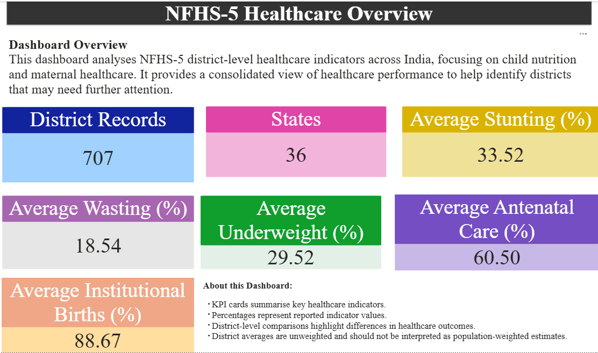

# 📊 NFHS‑5 Healthcare Analytics – District Intelligence

## 👋 Introduction

As a data analyst, I built this project to showcase my ability to work with large public health datasets, clean and transform data, and present insights through interactive dashboards.  
The dataset comes from **NFHS‑5 (National Family Health Survey)**, which provides district‑level indicators on child nutrition and maternal healthcare across India.

This portfolio project is designed to demonstrate the skills recruiters look for in data analysts: technical proficiency, analytical thinking, and clear storytelling.

---

## 🎯 Skills Demonstrated

- **Data Cleaning & Preparation**: Handling missing values, duplicates, and inconsistent formats  
- **Exploratory Data Analysis (EDA)**: Identifying trends and outliers in healthcare indicators  
- **Visualization**: Comparative charts and KPI summaries in Power BI  
- **Storytelling**: Translating raw numbers into actionable insights for decision‑makers  
- **Technical Tools**: Power BI, Python (Pandas, NumPy, Matplotlib), SQL  

---

## 📂 Dataset

- **Source**: NFHS‑5 District‑level indicators  
- **Records**: 707 districts across 36 states  
- **Key Metrics**:
  - Stunting (% of children under 5)
  - Wasting (% of children under 5)
  - Underweight (% of children under 5)
  - Antenatal Care (% mothers with early check‑ups)
  - Institutional Births (% births in healthcare facilities)

---

## 📈 Dashboard Highlights

### KPI Summary

- Average Stunting: **33.5%**  
- Average Wasting: **18.5%**  
- Average Underweight: **29.5%**  
- Average Antenatal Care: **60.5%**  
- Average Institutional Births: **88.7%**



---

### Child Nutrition – District Comparison

This section highlights disparities in child nutrition across districts:

- Top 10 districts with highest stunting, wasting, and underweight rates  
- Top 10 districts with lowest rates  


---

### Maternal Healthcare – District Comparison

This section compares maternal healthcare outcomes:

- Districts with highest antenatal care coverage  
- Districts with lowest antenatal care coverage  
- Institutional births: best vs worst performing districts  


---

## 🔍 Key Insights

## 🔍 Key Insights

- Districts in Bihar, Jharkhand, Uttar Pradesh, and Madhya Pradesh show **high child malnutrition rates**, with stunting and underweight indicators above the national average.  
- Districts in Kerala and Mizoram consistently rank among the **lowest malnutrition rates**, highlighting stronger nutrition outcomes.  
- **Maternal healthcare** indicators are uneven: Kerala and Tamil Nadu lead in **antenatal care** and **institutional births**, while parts of Nagaland and Bihar lag behind.  


---

## 🚀 How to Use

1. Clone this repository:

   ```bash
   git clone https://github.com/Yashashwini2001/NFHS-5-Healthcare-Analytics-District-Intelligence.git

